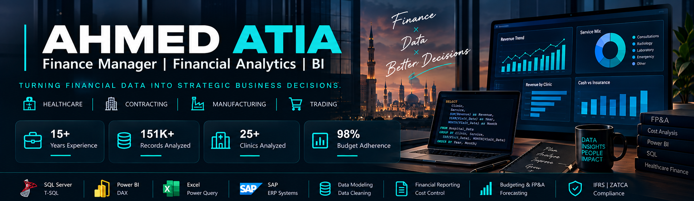
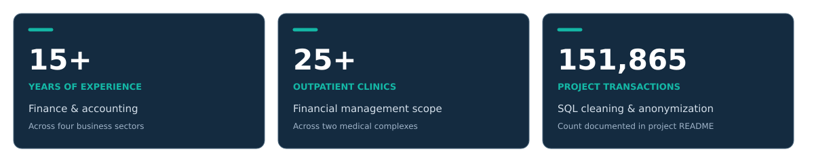
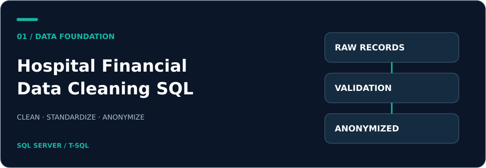
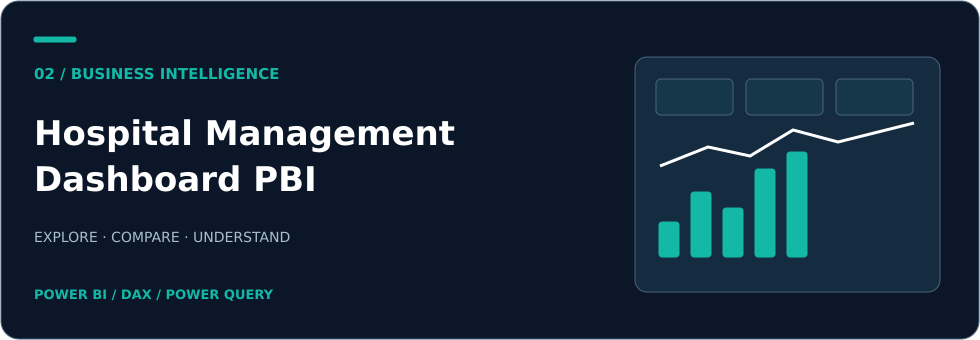
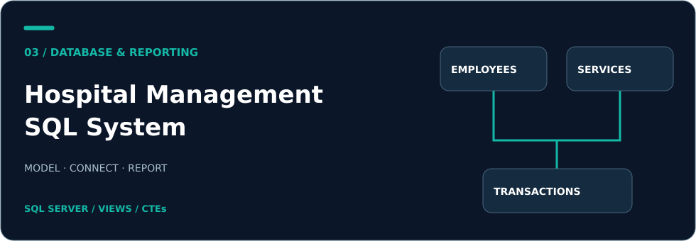

<!-- Executive Dark portfolio. Dashboard artwork in the banner is illustrative, not a screenshot of actual operational or financial data. -->

  

<h1 align="center">Ahmed Atia</h1>
<h3 align="center">Finance Manager | Financial Analytics | BI</h3>

Turning Financial Data into Strategic Business Decisions.

  <a href="#about-me">About</a> ·
  <a href="#tech-stack">Expertise</a> ·
  <a href="#impact-metrics">Impact</a> ·
  <a href="#featured-projects">Projects</a> ·
  <a href="#contact">Contact</a>

 

## About Me

I am a Finance Manager with over **15 years of experience** across **Healthcare, Contracting, Manufacturing, and Trading**.

My work combines financial management with practical data analytics: connecting budgets, operational activity, and financial reporting to help management understand performance and make informed decisions.

In healthcare, my responsibilities include budgeting, forecasting, clinic performance analysis, cost control, revenue cycle reporting, and cash flow planning across two medical complexes.

I use **SQL Server, Power BI, Power Query, and Advanced Excel** to prepare data, build analytical models, and turn recurring reports into useful management insights. My background also includes ERP implementation and financial process improvement.

**Core focus:** Financial Planning & Analysis · Management Reporting · Cost Control · Healthcare Analytics · Reporting Automation

 

## Tech Stack

| Area | Expertise & Tools |
| :--- | :--- |
| **Financial Planning & Analysis** | FP&A · Budgeting · Forecasting · Variance Analysis |
| **Financial Management** | Cost Control · Cash Flow Planning · Management Reporting |
| **Database & Querying** | SQL Server · T-SQL |
| **Business Intelligence** | Power BI · DAX · Data Modeling |
| **Data Preparation & Analysis** | Power Query · Advanced Excel |
| **ERP Systems** | SAP · ERPNext |
| **Financial Reporting & Compliance** | IFRS · ZATCA |

 

## Impact Metrics

<picture>
  <source media="(prefers-color-scheme: dark)" srcset="./assets/impact-metrics-dark.svg">
  <source media="(prefers-color-scheme: light)" srcset="./assets/impact-metrics-light.svg">
  
</picture>

*Career figures describe professional experience and financial management scope. The transaction count is documented in the linked SQL project. These figures describe scope and scale, rather than measured efficiency gains.*

 

## Featured Projects

### 01 · Hospital Financial Data Cleaning SQL

<a href="https://github.com/AHMEDATIAA85/Hospital-Financial-Data-Cleaning-SQL">
<picture>
  <source media="(prefers-color-scheme: dark)" srcset="./assets/project-sql-cleaning-dark.svg">
  <source media="(prefers-color-scheme: light)" srcset="./assets/project-sql-cleaning-light.svg">
  
</picture>
</a>

**Preparing healthcare financial data for reliable analysis.**

A SQL Server project covering **151,865 transactions**, focused on cleaning, standardization, anonymization, and financial validation.

- Monthly revenue trends and department-level revenue.
- Discount patterns and payment-method comparisons.
- Transaction volumes and average transaction value.

**Tools:** SQL Server · T-SQL · CTEs · CASE WHEN · Aggregations

**Business relevance:** Establishing a reliable analytical foundation before financial reporting and dashboard development.

[View Project →](https://github.com/AHMEDATIAA85/Hospital-Financial-Data-Cleaning-SQL)

 

### 02 · Hospital Management Dashboard PBI

<a href="https://github.com/AHMEDATIAA85/Hospital-Management-Dashboard-PBI">
<picture>
  <source media="(prefers-color-scheme: dark)" srcset="./assets/project-power-bi-dark.svg">
  <source media="(prefers-color-scheme: light)" srcset="./assets/project-power-bi-light.svg">
  
</picture>
</a>

**Making operational and financial performance easier to explore.**

A **two-page Power BI report** combining an operational overview with detailed performance analysis across branches.

- Revenue, patient count, and average visit cost.
- Branch and insurance-provider comparisons.
- Daily revenue trends, doctor performance, and service demand.

**Tools:** Power BI · DAX · Power Query · Data Modeling

**Business relevance:** Bringing key performance indicators into an interactive reporting experience for management review.

[View Project →](https://github.com/AHMEDATIAA85/Hospital-Management-Dashboard-PBI)

 

### 03 · Hospital Management SQL System

<a href="https://github.com/AHMEDATIAA85/Hospital-Management-SQL">
<picture>
  <source media="(prefers-color-scheme: dark)" srcset="./assets/project-sql-system-dark.svg">
  <source media="(prefers-color-scheme: light)" srcset="./assets/project-sql-system-light.svg">
  
</picture>
</a>

**Connecting relational database design with financial reporting.**

A healthcare SQL portfolio project linking employees, services, and transaction records through a relational database structure.

- Table design, primary keys, and foreign-key relationships.
- Doctor revenue reporting through SQL Views.
- Service-demand analysis and revenue aggregation.
- Analytical queries using joins, CTEs, and subqueries.

**Tools:** SQL Server · T-SQL · SSMS · Views · CTEs · Subqueries

**Business relevance:** Demonstrating how structured operational records can support consistent revenue and performance reporting.

[View Project →](https://github.com/AHMEDATIAA85/Hospital-Management-SQL)

*Project covers are illustrative designs, not screenshots or representations of measured financial results.*

 

## Contact

Connect with me to discuss financial management, financial analytics, and business intelligence opportunities.

**[LinkedIn](https://www.linkedin.com/in/ahmed-atiaa-6b246511b)** · **[WhatsApp](https://wa.me/966599681072)**

 

---

<strong>Financial Perspective. Analytical Depth. Business Impact.</strong>

